# T01: contrato propuesto para Hito 1

Fecha: 13/10/2026. Responsable de preparación: Codex. Estado: propuesta revisable, pendiente de aprobación del equipo. Este documento no acredita funcionalidad implementada ni autoriza aplicar SQL. Ver [decisiones](decisiones.md) y [tareas](tareas.md).

### Decisiones posteriores que prevalecen sobre la propuesta

D11 modificada por usuario: sin contactos/DNI compartidos entre personas ni opción de registrar aparte. Coincidencia bloquea alta y exige seleccionar frecuente; se permite otro pedido de la misma persona. Contrato actual elimina reconocerDuplicado; la propuesta histórica siguiente que lo admite está superada.

Segundo corte: D08 cerrada (todos los campos listados de cliente/dirección obligatorios; solo Piso/Depto y notas opcionales). Guardado/consulta de pedidos y frecuentes implementados según [spec T04](../frontend/specs/carga-persistida.md), migración 002 aprobada y aplicada con respaldo. No hay CRUD independiente de clientes ni borradores. El texto original de esta propuesta y su API/versiones completas no representan el corte implementado; ver [contrato vigente de acceso/pedidos](acceso-y-entorno.md).

El usuario resolvió el 13/10: no permitir pedidos nuevos incompletos; ABM independiente de Clientes para MVP 2; evaluar Georef con Leaflet y OSM; autorizar respaldo y aplicación exclusiva de migración de sesiones. La sesión de ocho horas y sus medidas técnicas se implementaron en el primer corte; ver [acceso y entorno](acceso-y-entorno.md). Las secciones de borradores y CRUD Clientes H1 de la propuesta original quedaron descartadas: no implementarlas. El resto del modelo de pedidos y obligatoriedad exacta de contactos siguen pendientes; T01 no está totalmente aprobada.

## 1. Alcance y evidencia

Hito 1 incluye saneamiento/importación histórica, gestión básica de entidades y flujo operativo inicial. Hito 2 incluye perfiles completos, reglas restantes y reportería. Adelantar autenticación en Hito 1 permite atribuir las confirmaciones a personas reales.

Fuentes: las dos consignas PDF contrastadas en la planificación; entrevistas resumidas en [contexto](contexto.md); maqueta y especificación del chofer inspeccionadas en este checkout. Los originales se conservan en `temp/`, fuera de Git; no son requisito para entender el contrato, sí para repetir la importación real.

Estado actual comprobado: Git limpio al inicio, rama main, commit 8633afa. App.jsx mantiene rol y permite ingresar a DriverApp; el chofer tiene paradas y cobros en memoria. Backend solo ofrece GET /. No hay API de negocio, autenticación real ni persistencia conectada al frontend. La descripción del 30/09 que rechaza al chofer está superada por el código.

| ID | Fuente / necesidad | Entrega y capacidad | Aceptación observable |
| --- | --- | --- | --- |
| R01 | Consigna general: histórico | H1, importar Clientes/Pedidos/Historial_Geo | Todas las filas conciliadas; repetir no duplica |
| R02 | Consigna general: CRUD | H1, gestión de clientes y pedidos | Alta, consulta, edición y baja/cancelación verificadas |
| R03 | Caso 7: dirección desordenada; entrevista: campos separados | H1, original y campos estructurados | Original conservado; operador revisa sugerencias; faltantes nunca se inventan |
| R04 | Caso 7: mapa antes del despacho | H1, normalizar/localizar y confirmar | Confirmación humana vigente exigida por API |
| R05 | Caso 7: estados inconsistentes | H1, códigos estables y tabla de equivalencias | Variante histórica mapeada; desconocida queda en revisión |
| R06 | Caso 7 e entrevistas: clientes repetidos/frecuentes | H1, buscar y advertir coincidencias | No fusiona ni sobrescribe automáticamente |
| R07 | Entrevistas: cuentas individuales | H1, admin/operador; H2, chofer operativo | Acciones y revisiones tienen usuario autenticado |
| R08 | Propuesta de MVP: chofer y pagos | H2, asignación, entrega y pago separados | Solo asignadas; acreditación definida antes de implementar |
| R09 | Consigna general: reportería | H2, mínimo a acordar en D12 | Informe calculado desde datos reales y defendible |
| R10 | Consigna general: participación | Todas, ramas/PR y revisión individual | Cada integrante explica entrada, validación y persistencia de su aporte |

No implementar stock, cupos o cuentas corrientes de otros casos. No incorporar integraciones automáticas con WhatsApp/Instagram ni optimización de rutas. El ABM de clientes de esta propuesta requiere aprobación D07; no se deduce de una tabla o de la demo.

## 2. Reglas concretas para aprobar

### Campos, borradores y duplicados (D07–D11)

- Cliente nuevo: nombre y al menos un contacto (email válido o teléfono). DNI opcional, almacenado como texto; si existe, solo dígitos y no fusiona entidades. CP opcional. No bloquear histórico porque falta DNI/contacto: conservarlo con advertencia de calidad para revisión.
- Gestión de clientes: listado, búsqueda, alta, edición y baja lógica. Operador gestiona datos; administrador decide baja/reactivación. Una baja impide nuevos pedidos para ese cliente, pero conserva sus pedidos existentes. No borrar físicamente clientes/pedidos/historiales.
- Carga nueva: cliente identificado y dirección original obligatorios; se permiten campos estructurados incompletos y se guarda como pendiente de revisión. Esto es una propuesta de borrador, no una excepción ya aprobada por el cliente.
- Dirección despachable: calle, altura positiva entera, localidad y provincia completas; latitud/longitud finitas válidas y confirmación vigente. CABA debe distinguirse de provincia de Buenos Aires. Piso/departamento opcionales. Cero, S/N o esquina sin altura requieren contacto/corrección; que el proveedor encuentre una esquina no completa el domicilio.
- Entrada libre: campo original más acción explícita para sugerir estructura. Campos separados siguen siendo editables. Las sugerencias no sustituyen el original ni se aplican silenciosamente. No estimar altura, localidad o un score de confianza.
- Cliente frecuente: búsqueda por DNI/email/teléfono. Coincidencia exacta de un identificador ofrece seleccionar; nombre parecido solo advierte. Al seleccionar, cambios en datos del cliente requieren acción explícita de edición; crear otro cliente exige reconocer la advertencia. No imponer unicidad de teléfono/email compartidos.
- Pedido nuevo: código interno generado en servidor; código histórico preservado. Mismo cliente o dirección no constituye duplicado. Alerta por mismo cliente, dirección estructurada y fecha de ingreso; permite continuar tras reconocimiento registrado. Repetición de la misma clave de envío HTTP devuelve el pedido previo, no otro pedido.
- Edición de dirección: una dirección operativa pertenece a un pedido. Cada cambio significativo de original, calle, altura, piso/departamento, localidad, provincia o CP crea una versión y elimina la confirmación vigente. Conservar todas las versiones y responsables. Cambiar solo observaciones del envío no invalida la ubicación.

### Matriz de permisos propuesta (D04)

| Acción / recurso | Administrador | Operador | Chofer |
| --- | --- | --- | --- |
| Sesión propia | Sí | Sí | H2; sin vista operativa real en H1 |
| Clientes: consultar, buscar, crear, editar | Sí | Sí | No |
| Clientes: baja/reactivación | Sí | No | No |
| Pedidos: listado, detalle, creación, edición predespacho | Sí | Sí | No en H1; solo asignados en H2 |
| Consultar proveedor, revisar y confirmar dirección | Sí | Sí | No |
| Habilitar pedido para despacho | Sí | Sí | No |
| Cancelar antes de despacho, con motivo | Sí | Sí | No |
| Importar histórico, administrar cuentas | Sí | No | No |
| Asignación, entrega, fallo y cobro | Definir en H2 | Definir en H2 | Solo asignados según acuerdo H2 |

La API valida siempre rol y recurso. Usuarios inactivos no pueden mantener una sesión operativa. La maqueta del chofer queda identificada como demo y aislada del login real durante H1; no constituye una autorización.

### Estados y transiciones propuestas (D04/D09)

Conservar los códigos actuales del SQL para reducir migración. Las etiquetas EN STOCK/EN PREPARACIÓN/EN ENVÍO mencionadas en entrevistas no se equiparan automáticamente: su correspondencia se acuerda en H2. Pago no es estado de dirección ni prueba de entrega.

| Origen | Acción | Destino | Condición |
| --- | --- | --- | --- |
| Nuevo | Crear | pendiente_validacion | Cliente y original presentes |
| pendiente_validacion / requiere_revision | Registrar fallo, resultado ambiguo o faltantes | requiere_revision | Conservar motivo e intento |
| pendiente_validacion / requiere_revision / direccion_validada | Confirmar ubicación | direccion_validada | Versión actual completa, intento de esa versión, responsable |
| direccion_validada | Habilitar despacho | listo_despacho | Confirmación vigente y dirección completa |
| pendiente_validacion / requiere_revision / direccion_validada / listo_despacho | Editar dirección | requiere_revision | Nueva versión, confirmación invalidada, historial |
| Cualquier estado predespacho | Cancelar | cancelado | Motivo obligatorio; no borrar |

En H1 no exponer un PATCH genérico que acepte cualquier estado. en_camino, entregado y fallido pueden existir como hechos históricos importados, pero sus transiciones operativas esperan H2. No editar/cancelar históricos terminales mediante el flujo predespacho. Una confirmación no implica habilitar ni realizar el despacho.

### Sesión propuesta (D02)

JWT firmado con secreto de entorno; duración absoluta de 8 horas, sin renovación automática. Cookie HttpOnly, SameSite=Lax, Secure en HTTPS, ruta /api; ningún token en localStorage. Persistir sesión con jti, usuario, expiración y revocación para cierre efectivo. Comprobar Origin permitido en operaciones mutantes; frontend y API bajo el mismo origen con proxy en desarrollo. No habilitar CORS abierto.

Hash mediante scrypt de Node con salt aleatorio por usuario. Cuenta inicial creada por comando administrativo con credenciales locales, nunca semillas públicas ni accesos demo. Limitar intentos de login y devolver un error genérico. Cambio de contraseña/inactivación revoca sesiones. Administración de cuentas en H1 mediante CLI local; interfaz administrativa se difiere.

## 3. Modelo relacional propuesto (D05/D10)

El siguiente DER es lógico y revisable; no es DDL aplicado. Mantener las seis entidades existentes y agregar solo las estructuras necesarias para versiones, sesiones e idempotencia del histórico.

```mermaid
erDiagram
    CLIENTES ||--o{ PEDIDOS : solicita
    DIRECCIONES ||--o| PEDIDOS : pertenece
    DIRECCIONES ||--|{ VERSIONES_DIRECCION : conserva
    VERSIONES_DIRECCION ||--o{ HISTORIAL_GEOLOCALIZACION : consulta
    USUARIOS o|--o{ VERSIONES_DIRECCION : revisa
    USUARIOS o|--o{ HISTORIAL_GEOLOCALIZACION : confirma
    PEDIDOS ||--o{ HISTORIAL_GEOLOCALIZACION : acumula
    PEDIDOS ||--o{ HISTORIAL_ESTADOS : registra
    USUARIOS o|--o{ HISTORIAL_ESTADOS : realiza
    USUARIOS ||--o{ SESIONES : inicia
```

Procedencia de importación es una tabla auxiliar transversal: archivo lógico, SHA-256, hoja, código original, fila, hash de contenido, entidad destino, clasificación, motivos y JSON original. No representa una FK polimórfica garantizada por MySQL; el importador verifica sus referencias dentro de la transacción.

| Entidad | Cambio mínimo propuesto / conflicto actual |
| --- | --- |
| clientes | Agregar dni nullable, activo y advertencias de calidad. Conservar codigo original; no imponer DNI retroactivo |
| direcciones | Relación 1:1 con pedido, versión actual y snapshot actual. No compartir una dirección mutable entre envíos |
| versiones_direccion | Nueva: direccion_id, version, snapshot original/estructurado, usuario nullable y fecha; UNIQUE(direccion_id, version). Versión histórica inicial sin responsable inventado |
| pedidos | Conservar código, agregar fecha_ingreso original, version para concurrencia, estado_original y clave de creación única. Despacho H1 solo listo_despacho; no agregar pago/asignación todavía |
| historial_geolocalizacion | Agregar versión de dirección, nomenclatura devuelta, fecha original, revisor original textual, usuario confirmado nullable, fecha de confirmación y pin confirmado. Booleano existente no basta. Conservar resultado/score original nullable; no inventar score del proveedor |
| historial_estados | Agregar usuario_id nullable, conservar usuario textual de origen y fecha histórica; cambios nuevos con responsable real |
| usuarios | Mantener admin/operador para H1; rol chofer y su autorización en H2 |
| sesiones | Nueva: jti único, usuario_id, expiración y revocación; no almacenar JWT completo |
| procedencia_importacion | Nueva: clave única (fuente lógica, hoja, código original), contenido original, hash, destino y clasificación |

Nuevas FK sin borrado en cascada de auditoría; restringir borrados físicos. Migración conserva las relaciones actuales, inspecciona si una dirección está compartida y crea snapshots independientes sin perder original. No reaplicar init.sql: CREATE TABLE IF NOT EXISTS no migra columnas y CREATE INDEX no es idempotente. Ensayar DDL y restauración en copia, porque un rollback de transacción no revierte todo el DDL de MySQL.

Confirmación: un intento solo puede confirmar la versión actual del mismo pedido. Guardar candidato seleccionado y pin aprobado, usuario/fecha; múltiples confirmaciones quedan auditadas. La consulta despachable requiere coincidencia de versión y no toma el booleano histórico como evidencia suficiente. En cada escritura bloquear/verificar la versión dentro de la transacción. HTTP externo ocurre fuera de la transacción; descartar resultado operativo tardío si cambió la versión y conservarlo como intento obsoleto.

## 4. Contrato API propuesto

Prefijo /api. JSON en camelCase, estados internos según tabla anterior. Fechas ISO 8601 con zona; IDs enteros positivos; desconocidos o tipos incorrectos rechazados. No exponer hash, cookie, mensajes SQL ni detalles internos. Error uniforme: `{ "error": { "code": "CODIGO", "message": "Mensaje para la persona", "fields": {} } }`. fields solo indica campos y errores, nunca repite datos personales.

Éxito de entidad: `{ "data": entidad }`; listado: `{ "data": [], "pagination": { "page": 1, "pageSize": 20, "total": 0 } }`. pageSize entre 1 y 100. Orden fijo fecha/id descendente en pedidos, nombre/id en clientes. 400 formato, 401 sesión, 403 permiso, 404 recurso inexistente/no autorizado por pertenencia, 409 versión o transición, 422 validación, 503 dependencia no disponible. Lectura/creación valida también autorización; no confiar en IDs de UI.

| Método y ruta | Entrada mínima | Salida / comportamiento |
| --- | --- | --- |
| GET /health/live | Sin sesión | 200 proceso disponible; sin datos de entorno |
| GET /health/ready | Sin sesión | 200 DB y versión de esquema disponibles; 503 si falla |
| POST /api/sesion | email, password | Usuario público y expiración; Set-Cookie; 429 al superar límite |
| GET /api/sesion | Cookie | Usuario actual, rol y expiración |
| DELETE /api/sesion | Cookie | 204, revocar sesión y expirar cookie |
| GET /api/clientes | q, activo, page, pageSize | Coincidencias sin selección ni fusión automática |
| GET /api/clientes/:id | ID | Cliente y advertencias de calidad |
| POST /api/clientes | nombre, contacto(s), dni opcional, reconocimientoDuplicado si aplica | 201 cliente; 409 con candidatos si falta reconocer coincidencia |
| PATCH /api/clientes/:id | version y campos editables | Actualización explícita; 409 ante edición concurrente |
| DELETE /api/clientes/:id | version | Baja lógica, 204; solo admin |
| POST /api/clientes/:id/reactivar | version | Cliente activo; solo admin |
| GET /api/pedidos | estado, fechaDesde, fechaHasta, page, pageSize | Lista con cliente, revisión geográfica y versión |
| GET /api/pedidos/resumen | fechaDesde, fechaHasta | Contadores por estado y pendientes de revisión; mismas reglas de filtro |
| GET /api/pedidos/:id | ID | Pedido, cliente, dirección actual, advertencias e historiales |
| POST /api/pedidos | clienteId, direccionOriginal, direccion estructurada, observaciones, canalOrigen, reconocimientoDuplicado; cabecera Idempotency-Key | 201 pedido inicial; misma clave/cuerpo devuelve previo, clave con cuerpo diferente 409 |
| PATCH /api/pedidos/:id | version, direccionOriginal/direccion u observaciones | Pedido actualizado; edición de dirección invalida confirmación |
| POST /api/pedidos/:id/geolocalizaciones | version, versionDireccion | Intento con candidatos, resultado, advertencias y posible obsolescencia |
| POST /api/pedidos/:id/confirmaciones | version, versionDireccion, intentoId, candidatoId, lat, lng y motivoAjuste si mueve pin | Confirmación auditada; coordenadas válidas y mismo intento/versión; no completa dirección faltante |
| POST /api/pedidos/:id/habilitar-despacho | version | Pedido listo_despacho solo si cumple invariantes |
| POST /api/pedidos/:id/cancelar | version, motivo | Pedido cancelado, conserva historial |

Entidades públicas incluyen version para concurrencia. Cliente incluye id, codigo, nombre, dni nullable, email, telefono, tipo, direccionFiscal, activo y advertencias; agregar version al modelo de clientes. Pedido incluye id, codigo, clienteId, fechaIngreso, canalOrigen, observaciones, estado, estadoOriginal nullable, version, direccion y confirmacion nullable. Dirección incluye id, versionDireccion, direccionOriginal, calle, altura, piso, departamento, localidad, provincia, codigoPostal, lat/lng nullable. Confirmación incluye intentoId, versionDireccion, usuarioId, fecha y lat/lng. Solo campos presentes cambian en PATCH; null limpia opcionales, no obligatorios.

Crear cliente y luego pedido permite reutilizar entidad sin sobrescritura implícita. Una falla al crear pedido no borra el cliente. Creación de pedido/dirección/versión/historial es atómica. API nunca admite confianza o confirmadoPorOperador como atajos enviados por frontend.

Importación no usa endpoint de carga pública: comando administrativo local con --dry-run por defecto, --apply explícito sobre base de prueba configurada. JSON de conciliación no imprime filas personales; el reporte detallado permanece local en temp/ y no se versiona.

## 5. Importación: evidencia y mapeo

Inspección directa del Excel el 13/10: tres hojas, cada una con 12 registros. Pedidos tiene 11 columnas; Clientes, 7; Historial_Geo, 10. DNI no existe. No se guardan nombres/contactos/filas personales en este documento.

Estados observados: pendiente (2), Pendiente (2), ENTREGADO (1), en camino (1), En Camino (1), fallido (1), Fallido (1), entregado (1), FALLIDO (1), duplicado? (1). Son 11 variantes para 12 pedidos; normalizar espacio/capitalización conserva el original. Alturas: 3 enteros positivos, 3 ausentes y 6 requieren revisión. Las 12 referencias de pedido a cliente existen; esto no acredita las demás reglas.

| Fuente | Destino y política |
| --- | --- |
| Clientes.cliente_id | clientes.codigo, siempre texto; id interno nuevo |
| nombre_completo, contacto, tipo_cliente, direccion_fiscal, fecha_alta | Datos del cliente y fecha original; no inventar DNI ni fusionar nombres parecidos |
| Pedidos.pedido_id, cliente_id, fecha_ingreso | Código, relación por código y fecha original |
| calle, numero, piso_depto, localidad, provincia, codigo_postal | Original reconstruido identificándolo como reconstrucción; snapshot de celdas intactas; estructura solo cuando sea inequívoca; piso_depto ambiguo preservado sin separar por conjetura |
| estado, notas_operador | Conservar originales y texto; pendiente → pendiente_validacion; en camino → en_camino; entregado → entregado; fallido → fallido; duplicado? → requiere_revision y advertencia |
| Historial_Geo.intento_id, pedido_id | Identidad original y relación al pedido |
| direccion_enviada_a_api, resultado_api, coordenadas, confianza_score, direccion_normalizada_api | Conservar respuesta histórica, nomenclatura y score; valores inválidos quedan en evidencia original y revisión, nunca reemplazados por cero |
| operador_que_reviso, fecha_intento | Responsable textual y fecha original; no crear usuarios ni confirmaciones atribuidas sin evidencia |

Clasificación excluyente por fila: aceptada, revisión (persistible con advertencia), rechazada (no persistible, por ejemplo referencia inexistente o código ausente). Total de cada hoja = suma de las tres categorías. Un histórico entregado puede conservar su estado aunque su dirección esté incompleta; no lo convierte en despachable ni habilita nuevas acciones.

Idempotencia: fuente lógica estable + hoja + código original; hash distingue mismo contenido de cambio. Mismo contenido es sin cambio; distinto contenido genera conflicto para revisión y no sobrescribe registros ya editados. SHA-256 del archivo identifica ejecución, no identidad del registro. Analizar todo antes de escribir; aplicar los persistibles y su procedencia en una transacción DML. Cambios de esquema ocurren antes y por separado. Una falla técnica revierte la ejecución; los rechazos de calidad aparecen en conciliación.

## 6. Proveedor y mapa: recomendación D06

Consulta documental del 13/10/2026; no se enviaron direcciones del Excel a ningún servicio. No se verificó cobertura real ni disponibilidad del endpoint.

| Opción | Evaluación para este TP |
| --- | --- |
| Georef | Documentación oficial argentina: normalización de texto e ubicación estimada, cobertura variable por región. Propuesta principal con revisión humana; no prometer exactitud domiciliaria ni SLA |
| Nominatim público | No propuesto como backend de este sistema: política exige decisión informada del desarrollador, máximo global 1 consulta/s, sin autocompletado ni datos personales/confidenciales; restricciones para aplicaciones de geocodificación/seguimiento |
| Google Geocoding + Google Maps | Alternativa que requiere revisar presupuesto/cuenta y condiciones de almacenamiento y mapa. No mezclar sus resultados con OSM ni adoptar sin acuerdo |

Recomendación: adaptador Georef configurable en servidor, timeout de 8 segundos y reintento explícito; no consultas por pulsación ni geocodificación automática al importar. Solo enviar dirección y contexto territorial, nunca datos del cliente. Ajustar endpoint/version al contrato oficial vigente y probar con direcciones públicas/sintéticas antes de habilitarlo.

Leaflet estable (no alpha) para mostrar mapa y pin; librería no es proveedor de geocodificación ni de cartografía. Para demostración de bajo tráfico se propone cartografía OSM con atribución visible, URL configurable, caché HTTP del navegador, Referer, sin precarga masiva ni modo offline; disponibilidad sin garantía. Si condiciones/carga no encajan, usar proveedor alternativo acordado. No instalar aún: D06 pendiente.

Fuentes oficiales revisadas:
- [Georef: direcciones, ubicación aproximada y cobertura variable](https://www.argentina.gob.ar/node/473623).
- [Georef: herramienta pública y abierta](https://www.argentina.gob.ar/georef/georef-servicio-de-normalizacion-de-direcciones-y-unidades-territoriales-de-argentina).
- [Leaflet: biblioteca de mapas](https://leafletjs.com/).
- [Política de teselas OSM](https://operations.osmfoundation.org/policies/tiles/).
- [Política de Nominatim](https://operations.osmfoundation.org/policies/nominatim/).
- [Políticas de Google Geocoding](https://developers.google.com/maps/documentation/geocoding/policies).

Licencias, cuotas/precio del servicio elegido y condiciones de retención específicas requieren comprobación final antes de integración; la documentación consultada no permite atribuir un SLA, cuota garantizada o precisión uniforme a Georef. No contratar servicios ni publicar datos históricos en un proveedor para probar cobertura.

## 7. Ejecución después de aprobación y aceptación

Orden: T02 entorno/migraciones → T06 histórico → T03 sesión → T04 clientes/pedidos → T05 revisión geográfica → T08 tablero y ensayo H1. Administración/importación local no requiere interfaz de login, pero sí entorno controlado. Antes de modificar UI crear spec en frontend/specs; reutilizar estilos/componentes actuales. H2 requiere acuerdo separado de permisos del chofer, estados comerciales, entrega/pago y reportes D12.

Pruebas necesarias, todavía no ejecutadas:
1. Migrar base vacía y copia existente; preservar recuentos y restaurar respaldo; segunda ejecución sin repetir migración.
2. Conciliar las 36 filas; importación repetida sin duplicados, archivo alterado con conflicto y fallo DML con rollback.
3. Login inválido, sesión ausente/expirada/revocada, Origin no permitido, operador intentando importar o dar baja, usuario inactivo.
4. CRUD cliente, contacto compartido, discrepancia explícita y baja que conserva pedidos; concurrencia de edición.
5. Crear/recargar pedido, campos incompletos, clave HTTP repetida y diferente contenido; transacción sin entidades huérfanas.
6. Proveedor exitoso/vacío/ambiguo/timeout/error; intento ajeno, respuesta tardía, pin inválido y cambio de dirección después de confirmar.
7. Solicitud directa para habilitar despacho sin confirmación: rechazo; confirmación vigente: aceptación; histórico entregado: sin transición indebida.
8. Tablero con histórico/nuevos, filtros/resumen coherentes, teclado y móvil 320 px sin desbordes; chofer demo claramente identificado.

Aprobación pendiente: aceptar o ajustar conjuntamente campos/borradores D08–D09, CRUD/baja D07, permisos/transiciones D04, versiones/confirmación D05/D10, duplicados D11, sesión D02 y recomendación geográfica D06. Esta es la propuesta concreta para revisar antes de implementar esas reglas.
