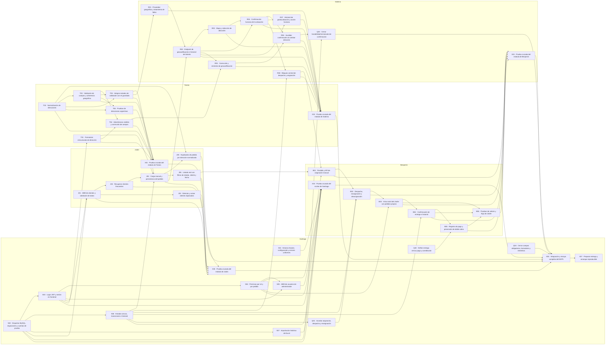

# Planificación visual del MVP 1 — Grupo 9

## Estado de lectura · 28/10/2026

Conservamos los registros fechados como evidencia histórica. Los estados de tablero, autorizaciones y comportamientos de cortes anteriores pueden estar superados: B01–B07 están finalizados en Jira, mientras X04/KAN-44 sigue pendiente. Para las reglas actuales del módulo usamos [decisiones](decisiones.md) y para la verificación integral y sus límites usamos [B06](entrega-b06.md). Una prueba automatizada no acredita una prueba cruzada realizada por un integrante.

Actualizado el 25/10/2026 sobre MVP-1 f87f6e1. 22 tareas cerradas por verificación técnica autorizada; 22 pendientes, ninguna en progreso.

- [Tablero Kanban](https://github.com/users/Benjabb2005/projects/1/views/1)
- [Vista por responsable](https://github.com/users/Benjabb2005/projects/1/views/2?groupedBy%5BcolumnId%5D=Assignees)

Se eligió GitHub Projects: ya usa el repositorio y permite estados, responsables y dependencias sin contratar otra herramienta. No se agregan fechas de Gantt porque el equipo no acordó un calendario. El proyecto es privado por defecto; para que compañeros o profesor lo vean, Benjamín debe darles acceso desde Settings → Manage access. No se enviaron invitaciones de acceso en esta tarea.

## Criterios

Pendiente: cierre no acreditado o trabajo no iniciado. En progreso: solo cuando el responsable confirme actividad. Hecho: implementación completa con evidencia técnica y autorización de revisión de Benjamín; no atribuye actividad actual de compañeros.

Los borradores locales generados con IA de asignación/chofer el 24/10 no fueron aprobados por Benjamín. B01–B06 permanecen Pendiente y no se atribuyen como avance de Benjamín. No se modificó código de producto ni se retiraron esos borradores durante esta planificación.

Las dependencias indican requisitos para integrar/cerrar el entregable; no impiden diseñar contratos ni hacer pruebas aisladas en paralelo. Hay 33 tareas de módulo, 4 decisiones y 7 tareas de pruebas/integración. Las tareas transversales conservan un coordinador y participantes: cantidad de tarjetas no equivale a esfuerzo.

Fuente: reparto de .agents/skills/ppp1-mvp1/SKILL.md y documentación. Pull hasta f87f6e1 (PR #6 de Julián y #7 de Sabrina). Las 33 tareas de módulo vienen del reparto; Q01–Q04 y X01–X07 son un desglose propuesto con asistencia de IA pendiente de validación del equipo, no once asignaciones nuevas aprobadas. Georef reemplaza Nominatim según D06. Falta probar proveedor real, MySQL y flujo visual.

## Santiago

| ID | Tarea | Estado por confirmar | Depende de |
| --- | --- | --- | --- |
| [S01](https://github.com/Benjabb2005/Practicas-Pre-Profesionales-1-Grupo-9/issues/8) | Entorno Docker, configuración y errores uniformes | Pendiente | — |
| [S02](https://github.com/Benjabb2005/Practicas-Pre-Profesionales-1-Grupo-9/issues/9) | Esquema MySQL, migraciones y cuentas de prueba | Hecho | — |
| [S03](https://github.com/Benjabb2005/Practicas-Pre-Profesionales-1-Grupo-9/issues/10) | Login JWT y sesión en frontend | Hecho | S02 |
| [S04](https://github.com/Benjabb2005/Practicas-Pre-Profesionales-1-Grupo-9/issues/11) | Permisos por rol y por pedido | Pendiente | S03 |
| [S05](https://github.com/Benjabb2005/Practicas-Pre-Profesionales-1-Grupo-9/issues/12) | ABM de usuarios de administrador | Hecho | S03, S04 |
| [S06](https://github.com/Benjabb2005/Practicas-Pre-Profesionales-1-Grupo-9/issues/13) | Estados únicos, transiciones e historial | Pendiente | S02 |
| [S07](https://github.com/Benjabb2005/Practicas-Pre-Profesionales-1-Grupo-9/issues/14) | Importación histórica de Excel | Hecho | S02 |
| [Q01](https://github.com/Benjabb2005/Practicas-Pre-Profesionales-1-Grupo-9/issues/41) | Acordar asignación, despacho y reasignación | Pendiente | S06 |
| [Q02](https://github.com/Benjabb2005/Practicas-Pre-Profesionales-1-Grupo-9/issues/42) | Definir entrega versus pago y acreditación | Pendiente | — |
| [Q04](https://github.com/Benjabb2005/Practicas-Pre-Profesionales-1-Grupo-9/issues/44) | Cerrar campos obligatorios, borradores y reintentos | Pendiente | — |
| [X05](https://github.com/Benjabb2005/Practicas-Pre-Profesionales-1-Grupo-9/issues/49) | Prueba cruzada del módulo de Julián | Pendiente | J01, J02, J03, J04, J05, J06 |
| [X06](https://github.com/Benjabb2005/Practicas-Pre-Profesionales-1-Grupo-9/issues/50) | Integración y ensayo completo del MVP1 | Pendiente | X01, X02, X03, X04, X05, Q03, Q04 |
| [X07](https://github.com/Benjabb2005/Practicas-Pre-Profesionales-1-Grupo-9/issues/51) | Preparar entrega y arranque reproducible | Pendiente | X06 |

## Julián

| ID | Tarea | Estado por confirmar | Depende de |
| --- | --- | --- | --- |
| [J01](https://github.com/Benjabb2005/Practicas-Pre-Profesionales-1-Grupo-9/issues/15) | ABM de clientes y validación de datos | Hecho | S02, S03 |
| [J02](https://github.com/Benjabb2005/Practicas-Pre-Profesionales-1-Grupo-9/issues/16) | Recuperar clientes frecuentes | Hecho | J01 |
| [J03](https://github.com/Benjabb2005/Practicas-Pre-Profesionales-1-Grupo-9/issues/17) | Detectar y avisar clientes duplicados | Hecho | J01 |
| [J04](https://github.com/Benjabb2005/Practicas-Pre-Profesionales-1-Grupo-9/issues/18) | Carga manual y persistencia del pedido | Hecho | J02, S06, T01, T05 |
| [J05](https://github.com/Benjabb2005/Practicas-Pre-Profesionales-1-Grupo-9/issues/19) | Duplicados de pedido por dirección normalizada | Hecho | J04, T02 |
| [J06](https://github.com/Benjabb2005/Practicas-Pre-Profesionales-1-Grupo-9/issues/20) | Listado real con filtros de estado, cliente y fecha | Hecho | J04 |
| [X01](https://github.com/Benjabb2005/Practicas-Pre-Profesionales-1-Grupo-9/issues/45) | Prueba cruzada del módulo de Tomás | Pendiente | T01, T02, T03, T04, T05, T06 |

## Tomás

| ID | Tarea | Estado por confirmar | Depende de |
| --- | --- | --- | --- |
| [T01](https://github.com/Benjabb2005/Practicas-Pre-Profesionales-1-Grupo-9/issues/21) | Formulario estructurado de dirección | Hecho | S03 |
| [T02](https://github.com/Benjabb2005/Practicas-Pre-Profesionales-1-Grupo-9/issues/22) | Normalización de direcciones | Hecho | — |
| [T03](https://github.com/Benjabb2005/Practicas-Pre-Profesionales-1-Grupo-9/issues/23) | Validación de campos y coherencia geográfica | Hecho | T02 |
| [T04](https://github.com/Benjabb2005/Practicas-Pre-Profesionales-1-Grupo-9/issues/24) | Advertencias visibles y corrección de campos | Hecho | T01, T03 |
| [T05](https://github.com/Benjabb2005/Practicas-Pre-Profesionales-1-Grupo-9/issues/25) | Integrar estados de validación con el guardado | Hecho | T02, T03 |
| [T06](https://github.com/Benjabb2005/Practicas-Pre-Profesionales-1-Grupo-9/issues/26) | Pruebas de direcciones argentinas | Hecho | T02, T03 |
| [X02](https://github.com/Benjabb2005/Practicas-Pre-Profesionales-1-Grupo-9/issues/46) | Prueba cruzada del módulo de Sabrina | Pendiente | R01, R02, R03, R04, R05, R06, R07, R08 |

## Sabrina

| ID | Tarea | Estado por confirmar | Depende de |
| --- | --- | --- | --- |
| [R01](https://github.com/Benjabb2005/Practicas-Pre-Profesionales-1-Grupo-9/issues/27) | Proveedor geográfico y tratamiento de fallos | Hecho | T05 |
| [R02](https://github.com/Benjabb2005/Practicas-Pre-Profesionales-1-Grupo-9/issues/28) | Endpoint de geocodificación e historial del intento | Hecho | J04, R01 |
| [R03](https://github.com/Benjabb2005/Practicas-Pre-Profesionales-1-Grupo-9/issues/29) | Mapa y selección de ubicación | Pendiente | R02 |
| [R04](https://github.com/Benjabb2005/Practicas-Pre-Profesionales-1-Grupo-9/issues/30) | Confirmación humana de la ubicación | Hecho | R02, R03 |
| [R05](https://github.com/Benjabb2005/Practicas-Pre-Profesionales-1-Grupo-9/issues/31) | Corrección y reintento de geocodificación | Hecho | R02, T04 |
| [R06](https://github.com/Benjabb2005/Practicas-Pre-Profesionales-1-Grupo-9/issues/32) | Invalidar confirmación al cambiar dirección | Hecho | R04, R05 |
| [R07](https://github.com/Benjabb2005/Practicas-Pre-Profesionales-1-Grupo-9/issues/33) | Historial de geolocalización y acción humana | Hecho | R02, R04 |
| [R08](https://github.com/Benjabb2005/Practicas-Pre-Profesionales-1-Grupo-9/issues/34) | Bloqueo central de despacho y asignación | Pendiente | R04, S06 |
| [Q03](https://github.com/Benjabb2005/Practicas-Pre-Profesionales-1-Grupo-9/issues/43) | Cerrar trazabilidad/versionado de confirmación | Pendiente | R06, S02 |
| [X03](https://github.com/Benjabb2005/Practicas-Pre-Profesionales-1-Grupo-9/issues/47) | Prueba cruzada del módulo de Benjamín | Pendiente | B01, B02, B03, B04, B05, B06 |

## Benjamín

| ID | Tarea | Estado por confirmar | Depende de |
| --- | --- | --- | --- |
| [B01](https://github.com/Benjabb2005/Practicas-Pre-Profesionales-1-Grupo-9/issues/35) | Pantalla y API de asignación manual | Hecho | J06, S04, R08 |
| [B02](https://github.com/Benjabb2005/Practicas-Pre-Profesionales-1-Grupo-9/issues/36) | Despacho, reasignación y desasignación | Hecho | B01, S06, Q01 |
| [B03](https://github.com/Benjabb2005/Practicas-Pre-Profesionales-1-Grupo-9/issues/37) | Vista móvil del chofer con pedidos propios | Pendiente | B02, S04 |
| [B04](https://github.com/Benjabb2005/Practicas-Pre-Profesionales-1-Grupo-9/issues/38) | Confirmación de entrega e historial | Pendiente | B03, S06 |
| [B05](https://github.com/Benjabb2005/Practicas-Pre-Profesionales-1-Grupo-9/issues/39) | Registro de pago y prevención de doble cobro | Pendiente | B04, Q02 |
| [B06](https://github.com/Benjabb2005/Practicas-Pre-Profesionales-1-Grupo-9/issues/40) | Pruebas de celular y flujo de chofer | Pendiente | B03, B04, B05 |
| [X04](https://github.com/Benjabb2005/Practicas-Pre-Profesionales-1-Grupo-9/issues/48) | Prueba cruzada del núcleo de Santiago | Pendiente | S01, S02, S03, S04, S05, S06, S07 |

## Dependencias completas

Cada flecha va de la predecesora a la tarea que la necesita. El mapa y la sección Depende de de cada tarjeta son la referencia completa. Se cargaron relaciones nativas en GitHub, pero la verificación de persistencia fue parcial; no se presentan las 98 como vínculos nativos comprobados.

## Comparación de herramientas gratuitas

Consultada el 25/10/2026 en fuentes oficiales:

| Herramienta | Encaje para cinco integrantes |
| --- | --- |
| GitHub Projects | Elegida: Kanban, tabla, roadmap, responsables y dependencias en el entorno que el equipo ya usa. |
| Zoho Projects | Alternativa: Free admite 5 usuarios y 3 proyectos; dependencias Finish-to-Start y Gantt de consulta según comparador. |
| ClickUp | Tablero gratuito útil, pero Gantt Free Forever limitado a 60 usos. |
| Trello | Free admite 10 colaboradores; responsables/estados cómodos, dependencias requieren más trabajo manual o complementos. |
| Asana | Personal gratuito limitado a 2 usuarios, no alcanza para el equipo. |

Fuentes: [GitHub Projects](https://github.com/features/issues), [dependencias en GitHub Free](https://docs.github.com/en/issues/tracking-your-work-with-issues/using-issues/creating-issue-dependencies), [Zoho](https://www.zoho.com/projects/zohoprojects-pricing.html), [comparador Zoho](https://www.zoho.com/projects/pricing-comparison.html), [ClickUp](https://help.clickup.com/hc/en-us/articles/32274881672599-Views-feature-availability-and-limits), [Trello](https://trello.com/pricing), [Asana](https://asana.com/pricing).

[Mapa visual completo publicado en GitHub](https://github.com/Benjabb2005/Practicas-Pre-Profesionales-1-Grupo-9/issues/52). Documento de consulta separado de las 44 tareas.

## Rectificación tras el pull

44 tareas en Pendiente hasta confirmación. Se retiraron las inferencias anteriores (7 En progreso y 20 Hecho) y se reabrieron los 20 issues que se habían cerrado automáticamente. Esto no significa que el código de los compañeros no exista. Primera tarea de Benjamín: B01, revisar contrato de asignación manual antes de implementar. El borrador anterior se conserva sin aprobar. No se agregan tareas por este merge.

## Cierre técnico verificado

El usuario pidió cerrar lo que ya está completo y funcionando: **22 Hecho / 22 Pendiente / 0 En progreso**. Las rectificaciones previas de 44 pendientes son historia, superada por esta auditoría. Evidencias y límites por módulo en docs/verificacion.md, apartado «Auditoría para cierre técnico de tareas (25/10/2026)». No se interpreta implementación parcial como actividad de compañeros ni se cierran decisiones o pruebas cruzadas sin evidencia.

## Actualización B01

B01 autorizada, implementada y verificada el 25/10/2026. Resultado actual: **23 Hecho / 21 Pendiente / 0 En progreso**. B02–B06 siguen pendientes; se supera la referencia histórica a B01 como borrador no aprobado. Ver evidencias específicas en docs/verificacion.md.

## Actualización B02

B02 implementada y probada el 25/10/2026. **24 Hecho / 20 Pendiente / 0 En progreso**. B03–B06 siguen pendientes, Q01 mantiene coordinación del equipo pendiente. Evidencias y límites en docs/verificacion.md. Cambios de este corte locales, no pusheados.
